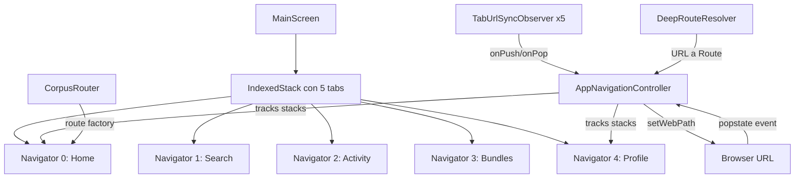

# ADR-001: Sistema de Navegación Custom con Historial por Pestaña

> **Estado:** Aceptado  
> **Fecha:** 2026-09-24  
> **Contexto:** Auditoría técnica, hallazgo F-01

---

## Contexto

Corpus usa 5 pestañas principales (Inicio, Búsqueda, Actividad, Bundles, Perfil) con navegación anidada: cada pestaña mantiene su propia pila de pantallas independiente. Además, en Web, la URL del navegador debe sincronizarse bidireccionalmente con la pantalla activa (deep linking).

**¿Por qué no `go_router`?** Al momento de implementar, `go_router` con `StatefulShellRoute` no cubría todos los requisitos:
1. Historial independiente por pestaña con persistencia al cambiar entre ellas
2. Sincronización bidireccional browser URL ↔ pila activa
3. Debounce de navegación (600ms entre pushes, para evitar dobles taps)
4. Bloqueo de `popRouteInformation` nativo en Web (que causaba parpadeos)
5. Manejo de deeplinks desde notificaciones push en un Navigator separado (root stack)

## Decisión

Se implementó un **router custom de ~1600 líneas** distribuido en 8 archivos:

```
lib/routes/
├── app_navigation_controller.dart  (567 líneas) — Cerebro: pilas de historial, sync con browser
├── corpus_router.dart              (493 líneas) — Factory de rutas + extension CorpusNavigation  
├── deep_route_resolver.dart        (273 líneas) — URL → datos (fetch de BD) → Route
├── tab_deep_route.dart             (200 líneas) — Modelo de rutas profundas por pestaña
├── tab_url_sync.dart               (118 líneas) — NavigatorObserver que notifica al controller
├── app_routes.dart                 (90 líneas)  — Constantes de nombres de ruta
├── nav_history_frame.dart          (18 líneas)  — Modelo de frame de historial
└── app_root.dart                   (27 líneas)  — RouteInformationParser bloqueado
```

## Arquitectura



### Flujo: Usuario pulsa un juego en pestaña Búsqueda

1. `CorpusNavigation.pushGameDetails(game)` → `Navigator.push()` en pestaña 1
2. `TabUrlSyncObserver` (pestaña 1) detecta push → `controller.onNavigatorPush(1, route)`
3. `AppNavigationController` añade `NavHistoryFrame` a la pila de pestaña 1
4. Si pestaña 1 es la activa, calcula `publicPath` (ej. `/buscar/juego/12345`) y llama `setWebPath()`
5. La URL se actualiza sin recargar la página

### Flujo: Usuario pulsa "atrás" en el navegador (Web)

1. `window.onPopState` → `AppNavigationController._onPopState()`
2. Compara el `token` del state con los tokens de la pila
3. Token menor → "atrás" → `Navigator.pop()` en la pestaña correcta
4. Token mayor → "adelante" → resuelve vía `DeepRouteResolver` y pushea
5. `_replaying = true` evita reentrada

### Flujo: App abierta desde URL profunda (ej. `/perfil/abc123`)

1. `DeepRouteResolver.tabAndRouteFromPath('/perfil/abc123')` → `(tab: 4, ProfileDeepRoute('abc123'))`
2. `MainScreen.initState()` cambia a pestaña 4 y programa push retrasado
3. `DeepRouteResolver.buildRoute()` hace fetch del perfil desde Supabase
4. La ruta se pushea en el Navigator 4

## Reglas para añadir una nueva ruta profunda

1. Definir el `TabDeepRoute` en `tab_deep_route.dart`
2. Añadir la constante en `app_routes.dart`
3. Registrar resolución URL → Route en `deep_route_resolver.dart`
4. Registrar resolución Route → URL en `deepRouteFromRouteSettings()` (`tab_deep_route.dart`)
5. Registrar el path público en `publicPathForTabRoute()` (`tab_deep_route.dart`)
6. Registrar el parsing de URL en `tabAndRouteFromPath()` (`tab_deep_route.dart`)

> **Total: 4 archivos a tocar para cada nueva ruta profunda.**

## Edge Cases Documentados

| Edge Case | Solución |
|-----------|----------|
| Doble tap → doble push | Debounce de 600ms en `CorpusRouter._lastPushTime` |
| Push en pestaña de fondo | Contabiliza en historial pero no toca URL hasta volver a esa pestaña |
| Modal sin URL propia | Añade entry de historial con path actual → "atrás" lo cierra |
| `popRouteInformation` nativo | Bloqueado en `AppRoot` con `SynchronousFuture(false)` |
| Atrás cambia de pestaña | Si pila vacía, cambia a pestaña donde está el token anterior |

## Consecuencias

**Positivas:** Control total, URL sync funcional, debounce previene bugs de doble-push.

**Negativas:** ~1600 líneas de infra, cada ruta nueva toca 4 archivos, sin tests, documentación solo en comentarios.

## Alternativas Consideradas

| Alternativa | Razón de rechazo |
|-------------|-----------------|
| `go_router` + `StatefulShellRoute` | No soportaba todos los edge cases al momento de implementar |
| `auto_route` | Demasiado opinionated para el modelo de pestañas custom |
| Navigator 2.0 puro | Complejidad similar con API más verbose |
